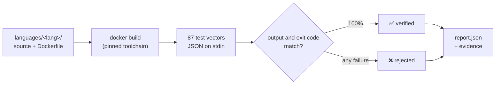

<div align="center">

# 🌍 Every Language

### One algorithm. Every programming language. Every implementation verified.

**From COBOL to Rust, from FORTRAN to Prolog: one real-world algorithm, written
by the community in every language that can run it, all checked by the same
test suite.**

[](https://github.com/openapi/every-language-fiscal-code/actions/workflows/verify.yml)
[](LANGUAGES.md)
[](test-vectors/)
[](SPECIFICATION.md)
[](LICENSE)
[](CONTRIBUTING.md)
[](#-hacktoberfest)

[**Add your language →**](CONTRIBUTING.md) · [Specification](SPECIFICATION.md) · [Languages](LANGUAGES.md) · [The challenge](CHALLENGE.md)

</div>

---

## 🎯 The challenge

Collecting snippets in many languages is easy. Showing that **a hundred
completely different programs behave identically** is not.

Each implementation in this repository:

- 🧠 **is written from scratch** in its own language, with no wrappers, no
  libraries that do the work and no API calls;
- 📦 **runs in its own container**, built from a pinned toolchain;
- ✅ **passes the same 87 test vectors** with identical JSON output;
- 🔍 **leaves evidence**: source hashes, environment, per-test results and logs.

Our first goal is **64 languages**, then **99**, **128**, **256** and beyond.
See [Why 64?](#-why-64) and the [roadmap](ROADMAP.md).

```text
64     2⁶    ▋░░░░░░░░░░░░░░░░░░░    2 / 64     ← we are here
99     🍺    ░░░░░░░░░░░░░░░░░░░░    2 / 99
128    2⁷    ░░░░░░░░░░░░░░░░░░░░    2 / 128
256    2⁸    ░░░░░░░░░░░░░░░░░░░░    2 / 256
```

## 🔢 Why 64?

Because computers count in powers of two, and **64 is the number computing
keeps coming back to**:

- **2⁶ = 64.** Six bits, `000000` to `111111`, are exactly enough to give every
  language on the board its own ID.
- **64-bit.** It is the word size of almost every processor running today:
  x86-64 in laptops and servers, ARM64 in phones and the cloud. Your code runs
  on 64 bits.
- **Base64.** Its 64-character alphabet carries binary data through text
  everywhere: email attachments, `data:` URLs, JSON Web Tokens.
- **Commodore 64 and Nintendo 64.** Two machines that brought generations to
  programming and gaming. The C64 is often cited as the best-selling single
  computer model of all time.
- **The 64 squares of a chessboard.** In the old legend, one grain of wheat on
  the first square, doubled on every next square, adds up to 2⁶⁴ − 1, which
  is also the largest unsigned 64-bit integer. It is still the classic way to
  explain exponential growth.

So we set the bar at 64 languages. Next comes **99**, a toast to
[*99 Bottles of Beer*](https://www.99-bottles-of-beer.net), the classic
collection of one song in a thousand languages. After that the ladder goes
back to binary: **128** is 2⁷, the size of the ASCII table, and **256** is 2⁸,
the values of a single byte.

## 🇮🇹 The algorithm: the Italian Fiscal Code

Every Italian resident has a 16-character *codice fiscale*. It looks simple,
but computing it exercises string manipulation, vowel and consonant rules, date
encoding, lookup tables and modular arithmetic. That makes it complex enough to
be a real program and small enough to write in COBOL or Assembly.

```text
            ROSSI · MARIO · 1980-01-01 · M · born in Rome (H501)

             RSS   MRA   80   A   01   H501   U
             │     │     │    │   │    │      └─ check character
             │     │     │    │   │    └──────── place of birth
             │     │     │    │   └───────────── day (+40 if female)
             │     │     │    └───────────────── month (A, B, C, D, E, H, L, M, P, R, S, T)
             │     │     └────────────────────── year
             │     └──────────────────────────── name consonants
             └────────────────────────────────── surname consonants
```

The full rules are in [SPECIFICATION.md](SPECIFICATION.md).

## 🗺️ Language board

| | Language | | Language | | Language | | Language |
|---|---|---|---|---|---|---|---|
| ✅ | [Python](languages/python) | 🙋 | C | 🙋 | Rust | 🙋 | Prolog |
| ✅ | [PHP](languages/php) | 🙋 | JavaScript | 🙋 | Java | 🙋 | Haskell |
| 🙋 | COBOL | 🙋 | FORTRAN | 🙋 | Go | 🙋 | Ruby |
| 🙋 | Common Lisp | 🙋 | Erlang | 🙋 | Ada | 🙋 | *…your favourite* |

✅ verified · 🙋 **wanted:** [pick an open issue](https://github.com/openapi/every-language-fiscal-code/issues?q=is%3Aissue+is%3Aopen+label%3Anew-language) or [propose another language](https://github.com/openapi/every-language-fiscal-code/issues/new?template=new-language.yml)

## ⚡ Try it in 30 seconds

You only need **Docker** and **bash**. Every toolchain, including the test
runner, lives in a container, so nothing gets installed on your machine.

```console
$ git clone https://github.com/openapi/every-language-fiscal-code.git
$ cd every-language-fiscal-code

$ echo '{"surname":"ROSSI","name":"MARIO","birth_date":"1980-01-01","sex":"M","birthplace_code":"H501"}' | ./elc run python
{"fiscal_code": "RSSMRA80A01H501U"}

$ ./elc test
LANGUAGE             STATUS     TESTS
PHP                  verified   87/87
Python               verified   87/87

Verified: 2/2 — report written to reports/report.json
```

| Command | What it does |
|---|---|
| `./elc list` | list implementations |
| `./elc test` | build and verify every implementation |
| `./elc test rust go` | verify only some of them |
| `./elc run <lang>` | pipe stdin through one implementation |
| `./elc shell <lang>` | open a shell inside a language image |

## ⚙️ How verification works



Every program speaks the same contract: **JSON in on stdin, JSON out on
stdout, exit code 0 or 1.** Containers run with networking disabled, so the
algorithm really has to be in the code.

## 🛣️ Roadmap

| | Milestone | Why | What happens |
|---|---|---|---|
| ✅ | Foundation | | Spec, 87 test vectors, dockerized runner, CI |
| 🎯 | **64** | 2⁶ | Built by the core team, ten languages per session |
| 🍺 | **99** | 99 Bottles of Beer | Community takes over; dashboard and Guinness application |
| 🔤 | **128** | 2⁷, ASCII | Historical machines and emulators |
| 💾 | **256** | 2⁸, one byte | Formal record attempt, second challenge (SHA-256) |
| 🚀 | **512 → 1024** | 2⁹ → 2¹⁰ | The long tail, and the moonshot |

No deadlines, just milestones. Full plan in [ROADMAP.md](ROADMAP.md).

## 🤝 Contribute a language

The unit of contribution is **one language not yet on the board**.

1. 🙋 [Pick a language issue](https://github.com/openapi/every-language-fiscal-code/issues?q=is%3Aissue+is%3Aopen+label%3Anew-language) and comment to claim it (or [propose a new one](https://github.com/openapi/every-language-fiscal-code/issues/new?template=new-language.yml)).
2. 📁 Create `languages/<lang>/` with your source, a `Dockerfile`, `run.sh` and `manifest.yaml`.
3. 🧪 Run `./elc test <lang>` until it shows 87/87.
4. 🚀 Open a Pull Request. CI verifies it and your name goes on the board.

Historical languages, esoteric runtimes and forgotten compilers are especially
welcome. See [CONTRIBUTING.md](CONTRIBUTING.md) for the rules and look at
[`languages/python`](languages/python) for a complete example.

## 🎃 Hacktoberfest

We take part in [Hacktoberfest](https://hacktoberfest.com)! Every language is
a self-contained, meaningful contribution: one folder, one program, 87 green
tests.

- Browse the [`hacktoberfest` issues](https://github.com/openapi/every-language-fiscal-code/issues?q=is%3Aissue+is%3Aopen+label%3Ahacktoberfest).
  Look for [`good first issue`](https://github.com/openapi/every-language-fiscal-code/issues?q=is%3Aissue+is%3Aopen+label%3A%22good+first+issue%22)
  if it is your first time.
- Comment on the issue to claim it, so nobody duplicates your work.
- Pull Requests that pass CI and follow [CONTRIBUTING.md](CONTRIBUTING.md) get
  the `hacktoberfest-accepted` label. Low-effort or spam PRs get `spam`.

## 🏆 A world record?

We would like to propose a new record: **the most programming languages used
to independently implement and execute the same algorithm.** It has **not**
been submitted or recognized yet. [RECORD.md](RECORD.md) explains the plan and
the evidence we are collecting.

## 📚 Learn more

- [CHALLENGE.md](CHALLENGE.md): vision and operating plan ([🇮🇹 original](docs/CHALLENGE.it.md))
- [SPECIFICATION.md](SPECIFICATION.md): the algorithm and the I/O contract
- [ROADMAP.md](ROADMAP.md): milestones from 64 to 1024
- [LANGUAGES.md](LANGUAGES.md): what counts as a distinct language
- [CODE_OF_CONDUCT.md](CODE_OF_CONDUCT.md)

---

<div align="center">

Promoted with ❤️ by [**Openapi**](https://openapi.com). Open to everyone, with no API keys, accounts or commercial services required.

<sub>A code computed here is the theoretical fiscal code for the given data, not necessarily the one officially assigned by the Italian Revenue Agency. All test data is synthetic. Released under the [MIT License](LICENSE).</sub>

</div>
